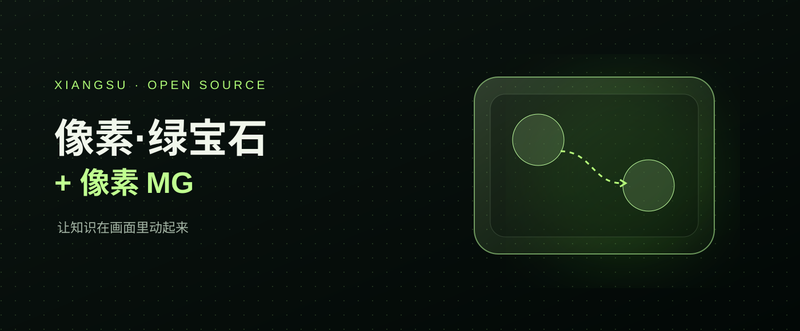
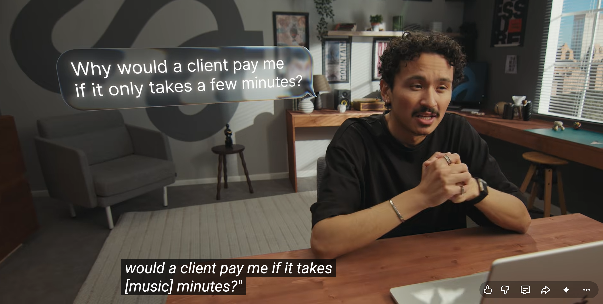
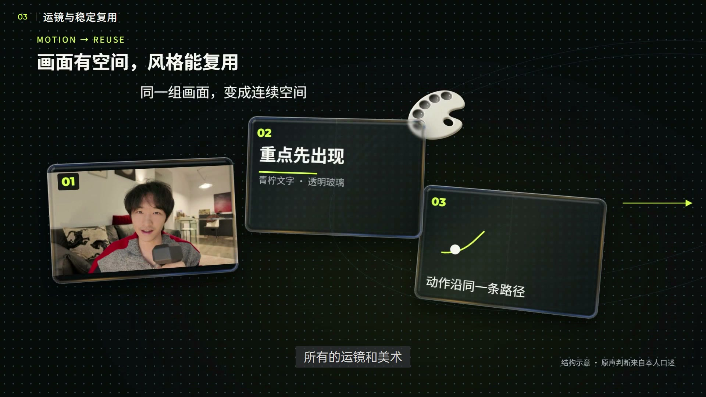

# 像素·绿宝石 & 像素 MG



让 AI 把一段**已经粗剪完成的横屏口播**编排成可编辑的视频工程：原声和真人画面保留，按内容加入重点文字、玻璃卡、素材画面与知识解释动画。也可以单独使用像素 MG，把文稿转为基于 HyperFrames 的知识动画。

| Skill | 适合做什么 |
| --- | --- |
| [像素·绿宝石](skills/xiangsu-lvbaoshi/SKILL.md) | 真人口播的整片编排、模板、玻璃材质、转场、字幕和动画交接 |
| [像素 MG](skills/xiangsu-mg/SKILL.md) | 把流程、关系、比较和机制做成可编辑的知识动画 |

<details>
<summary>查看视觉参考</summary>

玻璃与气泡的材质参考：



像素 MG 的青柠玻璃空间参考：



这些图片用于说明视觉方向；实际成片以自己的输入和审看结果为准。

</details>

## 第一次使用

把这个仓库地址和下面这句话发给能执行本地命令的 AI 助手：

> 请阅读这个仓库的 INSTALL.md，检查我的系统并完成首次安装和验证。然后使用 $xiangsu-lvbaoshi 包装我的粗剪视频。

也可以在安装好 Node.js 22.14+、Python 3 和 Git 后，自行运行：

```sh
git clone https://github.com/maverickgao8848/xiangsu-lvbaoshi.git
cd xiangsu-lvbaoshi
node install.mjs
```

之后继续阅读 **[首次安装与验证](INSTALL.md)**，安装官方配套 Skills 和 Pillow，并重新加载 AI 会话。安装器会下载锁定的 HyperFrames 运行时、FFmpeg、FFprobe 和 Chrome；遇到内容不同的同名 Skill 会停止并保留现有版本。首次安装需要网络。

## 它如何工作

```text
粗剪视频 + 可信字幕时间
       ↓
绿宝石：全文编排 → 模板和素材选型 → 可审阅的计划
       ↓                         ↘
HyperFrames 合成              像素 MG 制作机制动画
       ↓
可编辑工程 → 预览与调整 → 导出
```

提供你自己的粗剪视频、口播文字和经过校对的时间信息。完整工作流见 [绿宝石说明](skills/xiangsu-lvbaoshi/references/workflow.md)；单独制作动画见 [像素 MG](skills/xiangsu-mg/SKILL.md)。画面、素材和时间轴需结合具体项目审看；现有样例及安装通过并不等于任意新片已经验收。

绿宝石包含模板、玻璃与字幕资源、动作、转场和编排脚本。像素 MG 包含完整本地技能源码与风格资源。HyperFrames 官方 Skills 和可选的 [Lemo-Opuscar](https://github.com/lemomo-ai/lemo-opuscar) 通过各自上游安装；在线 Pixel2All 物件按需获取。实际使用时还需自行提供视频、素材与必要的服务账号。

## 开源与素材

本仓库自有代码和文档使用 [MIT License](LICENSE)，允许商业使用、修改和再分发。字体、参考图片、音效和上游代码以各自的许可或授权为准，并非全部重新授权为 MIT。OPPO Sans 随软件提供，保留原始版权和协议；其字体文件不得单独再分发。详见 [第三方资源说明](THIRD-PARTY.md) 与各资源目录中的许可、来源记录。

像素 MG 此前发布过非商业版本；本仓库中的自有代码以这里的 MIT 许可发布。历史版本各自的许可不因此被追溯改变。
